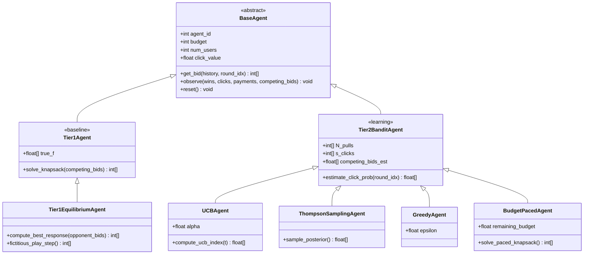

# Agents Architecture and Specifications

> **Project Title:** Learning to Bid Under a Budget: A Batched First-Price Ad Auction with Unknown Click Probabilities  
> **Source Reference:** [`Doc/main.tex`](file:///home/vivek/Documents/Fai/Doc/main.tex)  
> **Team Members:** Vivek Raj, Anvit Aggarwal, Eshaan Ashish Jaiswal, Gella Naga Sai Krishna  

---

## 1. System Overview & Auction Environment

In this project, multiple advertiser agents $A = \{a_1, \dots, a_m\}$ compete repeatedly over $T$ rounds to display ads to a fixed set of $n$ users $U = \{u_1, \dots, u_n\}$. Each user has an unknown, agent-specific click probability $f_{ij} = f(u_j, a_i) \in [0, 1]$.

```
                      ┌────────────────────────────────────────┐
                      │          Auction Platform              │
                      │  - Resolves highest bids per user      │
                      │  - Ties broken uniformly at random     │
                      │  - Charges winners their exact bid     │
                      │  - Simulates clicks: X ~ Ber(f_ij)     │
                      └────▲──────────────────────────────┬─────┘
                           │                              │
         Submits Bid Vector│                              │ Feedback:
        b_i = (b_i1,..,b_in│                              │ {w_ij, X_ij, b_ij, c_{-i,j}}
       s.t. sum(b_ij) <= B_│                              │
                           │                              ▼
                   ┌───────┴────────┐            ┌─────────────────┐
                   │ Advertiser a_1 │    ...     │ Advertiser a_m  │
                   │ (Learner/Equil)│            │ (Learner/Equil) │
                   └────────────────┘            └─────────────────┘
```

### 1.1 Round Execution Lifecycle
In each round $t \in \{1, \dots, T\}$:
1. **Strategy Commitment:** Every agent $a_i$ submits a batched bid vector $b_i^t = (b_{i1}^t, \dots, b_{in}^t)$ subject to integer bids $b_{ij}^t \in \{0, 1, \dots, B_i\}$ and budget constraint $\sum_{j=1}^n b_{ij}^t \le B_i$.
2. **Allocation & Pricing (First-Price):**
   - For each user $u_j$, highest bidder wins: $w_{ij}^t = \mathds{1}[b_{ij}^t = \max_k b_{kj}^t > 0]$ (with uniform random tie-breaking).
   - Winning probability: $q_{ij}(b^t)$.
   - Each winner pays its own bid $b_{ij}^t$ regardless of click outcome.
3. **Stochastic Realization & Utility:**
   - For won impressions ($w_{ij}^t = 1$), user click outcome is drawn: $X_{ij}^t \sim \mathrm{Bernoulli}(f_{ij})$.
   - Realized profit of $a_i$: $\sum_{j=1}^n w_{ij}^t (v X_{ij}^t - b_{ij}^t)$ where $v > 0$ is the click value (normalized to $v = 1$).
   - Expected utility: $p_i(b^t) = \sum_{j=1}^n q_{ij}(b^t)(f_{ij} v - b_{ij}^t)$.
4. **Information Feedback:**
   - **Semi-bandit feedback:** Agent $a_i$ observes click $X_{ij}^t$ only for users won ($w_{ij}^t = 1$).
   - **Competing bid revelation:** By Assumption 2, the agent observes the highest competing bid $c_{-i,j}^t = \max_{k \ne i} b_{kj}^t$ on each user.

---

## 2. Agent Taxonomy & Hierarchy



---

## 3. Detailed Agent Specifications

### 3.1 Tier 1: Full-Information Baseline Agents (Ground Truth)
Operate under known click probabilities $f_{ij}$. Used to establish theoretical ceilings and optimal game-theoretic benchmarks.

#### A. Knapsack Best-Response Agent (`Tier1KnapsackAgent`)
* **Role:** Calculates the optimal response against fixed, known competing bids $c_{-i}$.
* **Mechanism:**
  - Strict-win bidding: to win user $u_j$, agent must bid $c_{-i,j} + 1$.
  - Item value: $r_{ij} = f_{ij} v - (c_{-i,j} + 1)$.
  - Item weight (cost): $w_j = c_{-i,j} + 1$.
  - Solves the $0$--$1$ Knapsack Problem via dynamic programming in $O(n B_i)$:
    $$\max_{x \in \{0,1\}^n} \sum_{j=1}^n r_{ij} x_j \quad \text{s.t.} \quad \sum_{j=1}^n (c_{-i,j} + 1) x_j \le B_i$$
  - Submits $b_{ij} = (c_{-i,j} + 1) x_j^*$.

#### B. Game-Theoretic Equilibrium Agent (`Tier1EquilibriumAgent`)
* **Role:** Computes reference equilibrium profile $b^*$ in the finite normal-form game $(A, \{S_i\}, \{p_i\})$.
* **Methods:**
  - **Support Enumeration / Lemke-Howson:** For small instances ($m \le 3$, $n \le 5$).
  - **Fictitious Play & Best-Response Dynamics:** For medium instances to identify pure/approximate equilibria and monitor the equilibrium gap $\varepsilon(\sigma) = \max_i (\mathrm{BR}_i(\sigma_{-i}) - u_i(\sigma))$.

#### C. Social Planner Benchmark (`OmniscientPlanner`)
* **Role:** Computes the welfare-maximizing assignment without budget/competition frictions:
  $$u_j \to \arg\max_i f(u_j, a_i)$$
* **Usage:** Provides an upper bound on allocative efficiency ($\mathrm{Eff}_t$).

---

### 3.2 Tier 2: Single-Agent Bandit Learners (Combinatorial Semi-Bandits)
One agent learns $f(\cdot, a_i)$ online while opponents play fixed Tier-1 equilibrium pure bids $c_{-i,j}$.

#### A. Budget-Aware UCB Agent (`UCBAgent`)
* **State Tracked:**
  - $N_j$: number of impressions/observations for user $u_j$.
  - $s_j$: total observed clicks for user $u_j$.
  - $\hat{c}_{-i,j}$: last observed highest competing bid.
* **Bidding Algorithm (Algorithm 1):**
  1. **Round 1 (Probe):** Bid $b_{ij} = 0$ for all $j$. Incur 0 spend, observe initial competing bids $c_{-i,j}^1$.
  2. **Round $t \ge 2$:**
     - Compute UCB index for each user $j$:
       $$\tilde{f}_j = \begin{cases} 1 & \text{if } N_j = 0 \\ \min\left\{1, \frac{s_j}{N_j} + \sqrt{\frac{\alpha \ln t}{N_j}}\right\} & \text{if } N_j > 0 \end{cases}$$
       *(Default exploration hyperparameter: $\alpha = 2$)*
     - Set knapsack values: $r_j = \tilde{f}_j v - \hat{c}_{-i,j} - 1$.
     - Set knapsack weights: $w_j = \hat{c}_{-i,j} + 1$.
     - Solve $0$--$1$ Knapsack via DP under budget $B_i$.
     - Bid $b_{ij} = (\hat{c}_{-i,j} + 1) x_j^*$.
     - Update $N_j \gets N_j + 1$ and $s_j \gets s_j + X_{ij}^t$ for each won user.

#### B. Thompson Sampling Agent (`ThompsonSamplingAgent`)
* **Prior/Posterior:** Independent Beta priors for each user $j$: $\mathrm{Beta}(1 + s_j, \, 1 + N_j - s_j)$.
* **Bidding Logic:**
  - Draw posterior sample: $\tilde{f}_j \sim \mathrm{Beta}(1 + s_j, \, 1 + N_j - s_j)$.
  - Evaluate $r_j = \tilde{f}_j v - \hat{c}_{-i,j} - 1$ and solve the DP knapsack.
  - Submits strict-win bids on chosen users; updates Beta posterior with Bernoulli click feedback.

#### C. Baseline Comparison Agents
* **Greedy Agent (`GreedyAgent`):** Uses point empirical mean $\hat{f}_j = s_j / N_j$ without exploration bonus ($\alpha = 0$).
* **$\epsilon$-Greedy Agent (`EpsGreedyAgent`):** With probability $1 - \epsilon$ acts greedily; with probability $\epsilon$ selects a random feasible knapsack subset.

#### D. Budget-Paced Agent (`CumulativeBudgetPacedAgent`)
* **Variant:** Cumulative budget $B_i$ across all $T$ rounds (Remark 1, item 2).
* **Strategy:** Dual pacing via Lagrangian multiplier $\lambda_t \ge 0$ balancing current expected reward against remaining rounds and remaining budget, approximating the fluid LP relaxation of Bandits with Knapsacks (BwK).

---

### 3.3 Tier 3: Multi-Agent Concurrent Learners
* **Setting:** All $m$ advertisers simultaneously execute Algorithm 1 (UCB or Thompson Sampling).
* **Dynamics:**
  - Non-stationary environment: competing bids $c_{-i,j}^t$ evolve round-to-round as other agents update their click estimates.
  - No stationary single-agent regret guarantees apply.
  - Agents track empirical convergence to the Tier-1 equilibrium profile $b^*$.

---

### 3.4 Future & Extension Agents (Section 4)
1. **Contextual Combinatorial Bandit Agent (`LinUCBAgent`):**
   - User feature vector $z_j \in \mathbb{R}^d$.
   - Linear realizability: $f(u_j, a_i) = \phi(\theta_i^\top z_j)$.
   - Index: $\tilde{f}_j = \min\{1, \phi(\hat{\theta}_i^\top z_j + \beta \|z_j\|_{V_i^{-1}})\}$.
2. **Endogenous Reinvestment Agent (`ReinvestmentMDPAgent`):**
   - Evolving budget: $B_i(t+1) = B_i(t) + p_i(b^t)$. Formulated as a POMDP.
3. **Censored Win/Loss Learner (`MultipleChoiceKnapsackAgent`):**
   - Competing bids not revealed; agent learns winning probability distribution $\hat{q}_j(b) = \Pr(c_{-i,j} < b)$ from win/loss indicators alone. Solves a multiple-choice knapsack in $O(n B_i^2)$.

---

## 4. Standard Agent Interface Specification

To ensure seamless integration between baseline, single-agent, and multi-agent tiers, all agent implementations must adhere to the following interface:

```python
from abc import ABC, abstractmethod
from typing import Dict, Any, Optional
import numpy as np

class BaseAdvertiserAgent(ABC):
    """Abstract base class for all bidding agents."""

    def __init__(self, agent_id: int, budget: int, num_users: int, click_value: float = 1.0):
        self.agent_id = agent_id
        self.budget = budget
        self.num_users = num_users
        self.click_value = click_value

    @abstractmethod
    def get_bid(self, t: int, last_competing_bids: Optional[np.ndarray] = None) -> np.ndarray:
        """
        Computes and returns integer bid vector b_i of shape (num_users,)
        Must satisfy:
            b_ij in {0, ..., budget}
            sum(b_ij) <= budget
        """
        pass

    @abstractmethod
    def observe(
        self,
        won: np.ndarray,            # bool array of shape (num_users,)
        clicks: np.ndarray,         # binary array (1 if click, 0 otherwise) for won users
        payments: np.ndarray,       # payments deducted for won users
        competing_bids: np.ndarray  # highest competing bid per user c_{-i, j}
    ) -> None:
        """Updates internal beliefs and statistics from round feedback."""
        pass

    @abstractmethod
    def reset(self) -> None:
        """Resets beliefs and statistics for a new trial/seed."""
        pass
```

---

## 5. Metrics & Evaluation Framework

| Metric | Mathematical Definition | Target / Purpose |
| :--- | :--- | :--- |
| **Cumulative Regret** | $\mathrm{Reg}_T^{(i)} = \sum_{t=1}^T \left( p_i^*(c_{-i}^t) - \mathbb{E}[p_i(b_i^t, b_{-i}^t)] \right)$ | Sublinear growth $o(T)$ in Tier 2 |
| **Equilibrium Gap** | $\varepsilon_t = \max_{i} \left( \max_{b_i' \in S_i} p_i(b_i', b_{-i}^t) - p_i(b^t) \right)$ | $\varepsilon_t \to 0$ as $t \to \infty$ in Tier 3 |
| **Equilibrium Distance** | $\|b^t - b^*\|_1 = \sum_{i,j} |b_{ij}^t - b_{ij}^*|$ | Measures empirical convergence |
| **Allocation Efficiency** | $\mathrm{Eff}_t = \frac{1}{n} \sum_{j=1}^n \mathds{1}\left[\sum_{i \in \arg\max_k f_{kj}} w_{ij}^t = 1\right]$ | Evaluates welfare loss vs true optimal |
| **Advertiser Profit** | $p_i(b^t) = \sum_{j=1}^n q_{ij}(b^t)(f_{ij} v - b_{ij}^t)$ | Measures economic return under learning |
| **Platform Revenue** | $\mathrm{Rev}(b^t) = \sum_{i,j} q_{ij}(b^t) b_{ij}^t$ | Evaluates market thickness and auctioneer take |
| **Price of Learning** | $\Delta_{\mathrm{metric}} = \mathrm{Metric}(\text{Tier 1}) - \mathrm{Metric}(\text{Tier 3})$ | Quantifies loss from incomplete information |

---

## 6. Experimental Parameter Matrix

Configurations to be simulated across 30 independent random seeds (with 95% confidence intervals):

* **Advertisers ($m$):** $\{2, 3, 5\}$
* **Users ($n$):** $\{5, 10, 20, 50\}$
* **Budget Tightness ($\kappa = \frac{B_i}{\sum_j (c_{-i,j}+1)}$):** $\{0.1, 0.25, 0.5, 1.0\}$
* **Horizons ($T$):** up to $10^4$ rounds
* **Round Structures:**
  1. *Canonical:* Budget resets every round (independent per-round knapsack).
  2. *Discounted:* Per-round budget with discount factor $\gamma^t$.
  3. *Cumulative:* Single total budget depleted across rounds (pacing required).
* **Click Probabilities ($f_{ij}$):** Generated from Beta distributions with controllable variance and correlation.

---

## 7. Team Task Division & Agent Ownership

```
Phase 0: Shared Interfaces & Formalization (All)
   │
   ├── Phase 1: Vivek Raj
   │   └── Tier 1 Knapsack DP Baseline, Best-Response Dynamics & Equilibrium Solvers
   │
   ├── Phase 2: Anvit Aggarwal
   │   └── Tier 2 UCB, Thompson Sampling, Greedy & Budget-Paced Bandit Learners
   │
   ├── Phase 3: Eshaan Ashish Jaiswal
   │   └── Tier 3 Multi-Agent Simulator & Non-stationary Learning Convergence
   │
   └── Phase 4 & 5: Gella Naga Sai Krishna
       └── Evaluation Harness, Sensitivity Analysis Across (m, n, kappa) & Final Report
```
