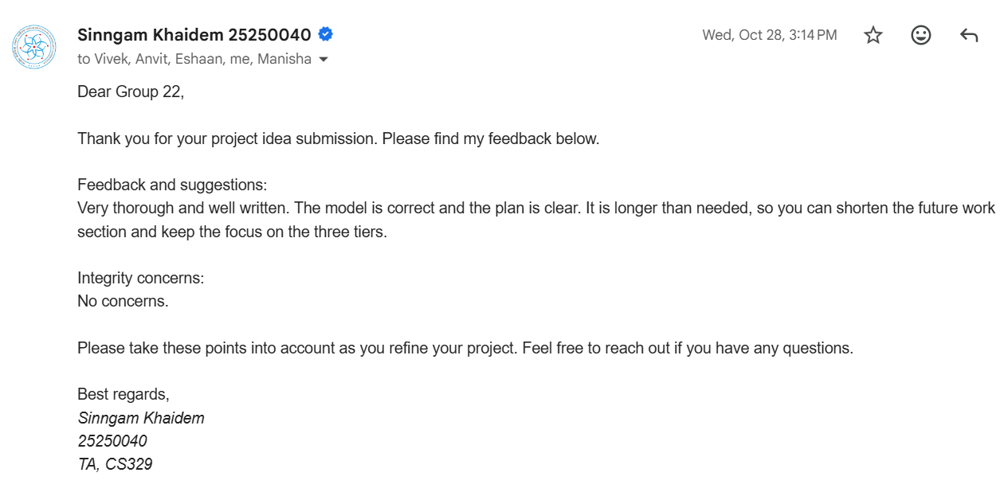
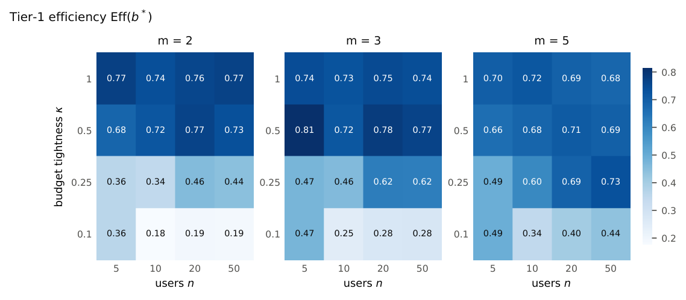
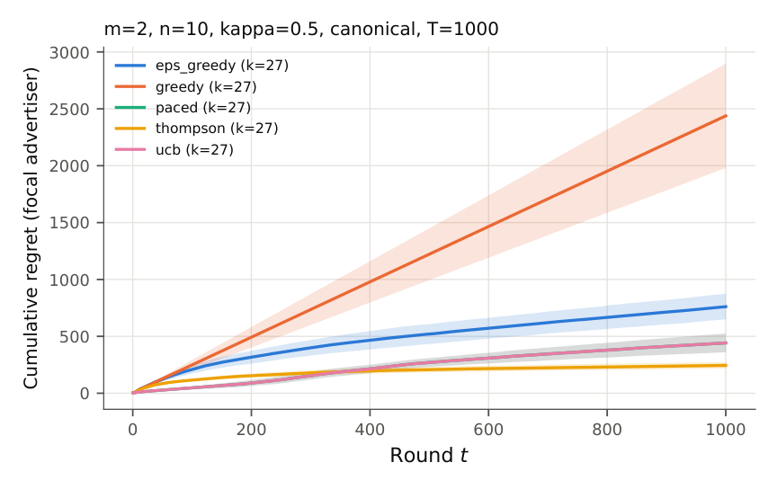
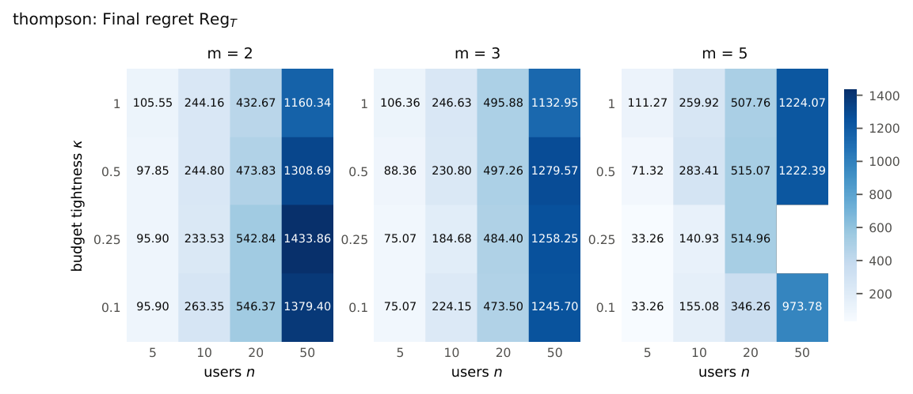
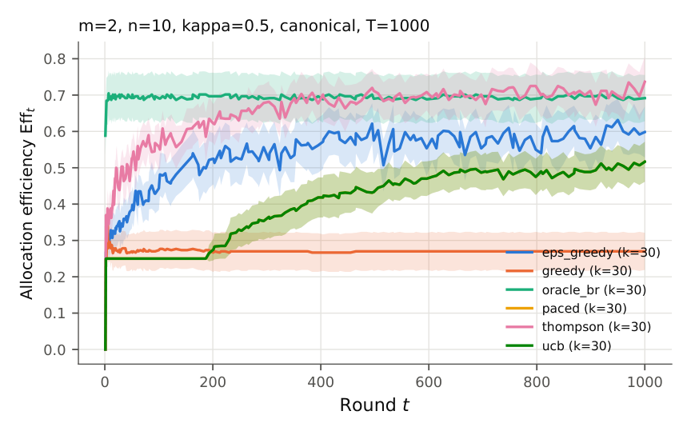
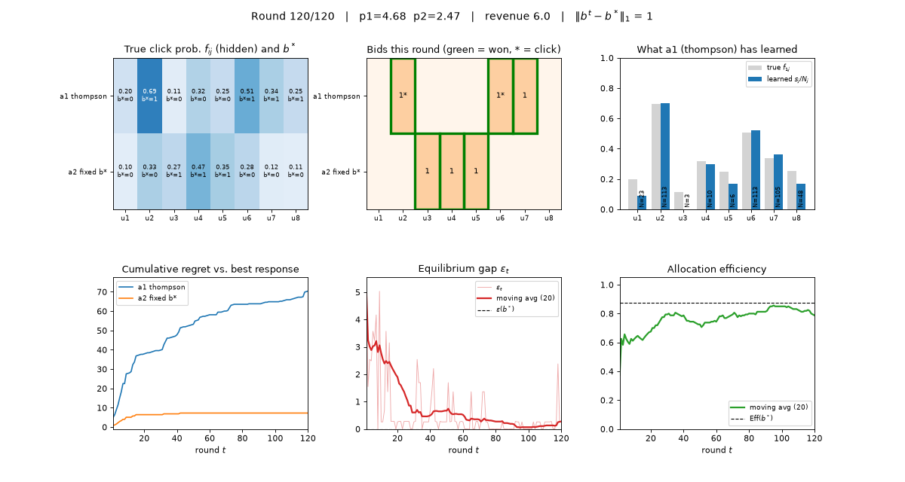

# Learning to Bid Under a Budget

**A batched first-price ad auction with unknown click probabilities.**
CS329 Foundations of AI, Group 22, IIT Gandhinagar. Vivek Raj, Anvit Aggarwal, Eshaan Ashish Jaiswal, Gella Naga Sai Krishna.

Repository: <https://github.com/VivekRaj2708/FAI-Group22>

| Document | Link |
|---|---|
| **Final report (8 pages, PDF)** | [report/final_report.pdf](https://github.com/VivekRaj2708/FAI-Group22/blob/main/report/final_report.pdf) (LaTeX source: [report/final_report.tex](report/final_report.tex)) |
| **Project proposal (PDF)** | [proposal/project_proposal.pdf](https://github.com/VivekRaj2708/FAI-Group22/blob/main/proposal/project_proposal.pdf) (LaTeX source: [proposal/project_proposal.tex](proposal/project_proposal.tex)) |
| TA review of the proposal | [shown below](#ta-review-of-the-proposal) ([image](proposal/TA_review.png)) |
| Per-cell results (every cell, mean and 95% CI) | [results/](results/) (`sweep_*/summary.csv`) |
| Live demo | `python run_demo.py`, or open [demo/index.html](demo/index.html) in a browser |

### TA review of the proposal



As the review suggested, the final report keeps future work to one short paragraph and focuses on the three tiers.

---

## 1. The problem

`m` advertisers compete for a fixed set of `n` users over `T` rounds. In each round every advertiser submits
**one integer bid per user**, with the bids summing to at most its budget `B_i`. On each user the highest bid
wins, ties are broken at random, and the winner **pays its own bid** whether or not the user clicks. User `j`
clicks advertiser `i`'s ad with probability `f_ij`. The advertisers **do not know** `f_ij` and only see clicks
on users they won.

When `f` is known, the best response to competing bids `c` is a **0-1 knapsack**: winning user `j` costs
`c_j + 1` and is worth `f_ij * v - (c_j + 1)`. It is solved exactly by dynamic programming in `O(n B_i)`.
Every learner in this project plugs an estimate of `f` into the same knapsack.

We relax one assumption at a time:

| Tier | Setting | What we compute |
|---|---|---|
| **1** | `f` known | Exact knapsack best responses, reference equilibrium `b*`, social-planner benchmark |
| **2** | One advertiser learns `f`; opponents fixed at `b*` | Regret of Thompson sampling, UCB, greedy, ε-greedy and a budget-paced learner |
| **3** | All advertisers learn at once | Equilibrium gap, distance to `b*`, efficiency, revenue, price of learning |

No model is trained offline. Each advertiser learns online, as a combinatorial semi-bandit: per user it keeps
win and click counts, which feed a UCB index or a Beta posterior.

---

## 2. How to run

Requires Python 3.10+.

```bash
pip install -r requirements.txt

python run_tests.py         # 57 tests: Tier 1, Tier 2, Tier 3, evaluation harness, demo
python report_numbers.py    # recomputes every number in the final report (see Section 4)
python check_tie_deviations.py   # checks the Tier-1 profiles against tie-bid deviations (about 10 s)
python run_demo.py          # live, animated market using the real agents
```

### Single experiments for each tier

```bash
# Tier 1: knapsack best responses and reference equilibrium b* for one instance
python run_tier1.py --m 2 --n 4 --kappa 0.5 --v 5.0 --output tier1_benchmark.json

# Tier 2: all learners against fixed b* opponents, regret curves
python run_tier2.py --rounds 200 --trials 5 --plot tier2_regret_curves.png --output tier2_benchmark.json
python run_tier2.py --round-structure cumulative --rounds 200     # campaign budget; includes the paced learner

# Tier 3: every advertiser learns (populations: all_ucb, all_ts, mixed_ucb_ts, mixed_all, learner_vs_equilibrium)
python run_tier3.py --m 2 --n 4 --population all_ts --rounds 300 --trials 5 --plot tier3_convergence_plots.png

# Evaluation harness: any registered agent, 30 seeds, curves and a summary with 95% CIs
python run_evaluation.py agents
python run_evaluation.py run --scenario tier3 --learner thompson --m 2 --n 10 --kappa 0.5 --T 1000
```

Run each script with `--help` to see all of its options (round structure, α, ε, discount factor, seeds).

### Live demo

```bash
python run_demo.py --scenario tier2 --learner thompson    # one learner vs. b* opponents
python run_demo.py --scenario tier3 --learner ucb --m 3   # everyone learns
python run_demo.py --agents thompson ucb greedy           # head-to-head market
python run_demo.py --headless --T 200                     # text log only, no window
```

`demo/index.html` is a JavaScript version of the same demo that runs in any browser without installing anything.

---

## 3. Results

At T = 1000, results use 30 seeds per cell over `m ∈ {2,3,5}`, `n ∈ {5,10,20,50}` and budget level
`κ ∈ {0.1,0.25,0.5,1}` (48 cells); the T = 10⁴ study uses 4 of these cells. Click probabilities are
`f_ij ~ Beta(2,5)` and the click value is `v = 5`. Shaded bands in the figures are 95% confidence intervals.

**Tier 2: one learner, horizon T = 1000** (means over the 47 cells that have a pure equilibrium)

| Learner | Regret / round | Regret exponent (T = 10³ / 10⁴) | Cells with lowest regret |
|---|---|---|---|
| Thompson sampling | **0.49** | **0.33 / ~0.2** | **47 / 47** |
| UCB, α = 0.5 | 0.73 | 0.46 / 0.23–0.38 | – |
| UCB, α = 2 | 1.77 | 0.73 / 0.50–0.58 | 0 |
| ε-greedy (ε = 0.1) | 1.22 | 0.66 / 0.80–0.84 | 0 |
| Greedy | 2.95 | 0.79 / 0.96–1.00 | 0 |

The 292 seeds without a pure equilibrium (mostly `m = 5`, `n ≥ 20`) are left out of this table. Keeping them, with the opponents fixed at the last best-response-dynamics profile, does not change the ranking: Thompson sampling has the lowest regret in all 48 cells, and in 21 of 22 cells on the dropped seeds alone (`results/sweep_all_seeds/`, `python report_numbers.py --section lim`).

The regret exponent is the fitted slope of log regret against log t: 1 means linear regret, 0.5 means √T-type, and smaller values mean slower growth. It is an empirical fit, not a proven rate.

**Tier 3: all advertisers learn** (canonical budgets, T = 1000)

| Learner | Final equilibrium gap, m = 2 / 3 / 5 | Final efficiency | Efficiency loss vs. Tier 1 |
|---|---|---|---|
| Known-f best response (control) | 0.76 / 1.42 / 2.37 | 0.53 | 0.04 |
| Thompson sampling | **0.67 / 1.25** / 2.48 | **0.56** | **0.02** |
| UCB, α = 2 | 2.32 / 3.67 / 4.93 | 0.35 | 0.23 |
| Greedy | 4.79 / 4.82 / 4.42 | 0.29 | 0.29 |

**Findings**
- **H1 holds.** Regret is sublinear for every learner whose exploration decays. Thompson sampling is best in all 47 cells; greedy's regret is close to linear.
- **H2 holds.** The gap to equilibrium grows with `m`. With Thompson sampling, nearly all of the gap is already present with known `f`, because simultaneous best responses cycle.
- **H3 is not supported.** Scarce budgets lower efficiency through the equilibrium itself, not by slowing learning.
- **Cumulative (campaign) budgets:** the budget-paced learner is the only one still earning at the end of the campaign, and it has the smallest Tier-3 gap.
- **Caveat on `b*`:** the reference profile is an equilibrium only for deviations that bid `c + 1` or `0` on each user, the same bids our learners use. If a deviation may also tie a rival's bid, some advertiser can gain in 62% of the profiles (median gain 8% of its profit), mostly at larger budgets. `python check_tie_deviations.py` reproduces this.

### Screenshots

**Tier 1: efficiency of the reference equilibrium.** Scarce budgets cost efficiency even when `f` is known.



**Tier 2: cumulative regret** (m = 2, n = 10, κ = 0.5), T = 1000 (left) and T = 10⁴ (right).

<p>


</p>

**Tier 2: Thompson sampling final regret in every (m, n, κ) cell.**



**Tier 3: equilibrium gap and allocation efficiency** (m = 2, n = 10, κ = 0.5).

<p>


</p>

**Tier 3 over T = 10⁴:** the gap keeps shrinking for Thompson sampling and UCB, but not for greedy.


**Live demo:** bids, wins, clicks, learned vs. true click rates, regret, gap and efficiency.



---

## 4. Checking the numbers in the report

The sweep outputs behind the report are committed in `results/sweep_*/` (`summary.csv`, plus the exact settings in `spec.json`).

```bash
python report_numbers.py                 # every table and in-text number of the final report
python report_numbers.py --section t2    # one section: t1 | t2 | t3 | rob | lim
```

To rerun the sweeps from scratch and rebuild the figures (the four used in the report are in `report/figures/`, with the same file names):

```bash
python run_evaluation.py sweep --preset tier1 --T 1000 --out results/sweep_tier1
python run_evaluation.py sweep --preset paper --T 1000 --structures canonical cumulative \
    --learners ucb thompson greedy eps_greedy paced --scenarios tier2 tier3 --out results/sweep_learners
python run_evaluation.py sweep --preset paper --T 1000 --structures discounted \
    --learners ucb thompson greedy eps_greedy paced --scenarios tier2 tier3 --out results/sweep_discounted
python run_evaluation.py sweep --preset paper --T 1000 --structures canonical \
    --learners ucb_a05 ucb_a1 --scenarios tier2 tier3 --out results/sweep_ucb_alpha
python run_evaluation.py sweep --preset paper --T 10000 --m 2 3 --n 10 20 --kappa 0.5 --structures canonical \
    --learners ucb ucb_a05 thompson greedy eps_greedy --scenarios tier2 tier3 --out results/sweep_horizon
python run_evaluation.py sweep --preset paper --T 1000 --structures canonical --include-mixed \
    --learners ucb thompson greedy eps_greedy --scenarios tier2 --out results/sweep_all_seeds
python run_evaluation.py report --sweep-dir results/sweep_tier1 results/sweep_learners \
    results/sweep_discounted results/sweep_ucb_alpha results/sweep_horizon --report-dir results/report_assets
```

The full learner sweep takes about 20 minutes on 14 cores; add `--workers N` to set the number of parallel processes.
To compile the report, run `pdflatex final_report` twice inside `report/`, or upload the `report/` folder to Overleaf.

---

## 5. Repository layout

```
src/
  env/        auction engine (batched first-price, tie-breaking, feedback) and instance generator
  tier1/      knapsack DP, equilibrium solvers (exhaustive search, BRD, fictitious play), social planner
  tier2/      learners (UCB, Thompson sampling, greedy, ε-greedy, budget-paced) and single-learner simulation
  tier3/      multi-agent simulator, convergence-rate and cycling analysis, price of learning
  agents/     shared agent interface (get_bid / observe / reset) and the agent registry
  eval/       evaluation harness: metrics, 95% CIs, parameter sweeps, plots, LaTeX tables
tests/        test suites for every tier, the harness and the demo
results/      committed sweep summaries used by the report
report/       final_report.pdf, final_report.tex, arxiv.sty
report/figures/  the report's 4 figures (PDF) and the README screenshots (PNG)
proposal/     submitted proposal (PDF and LaTeX source) and the TA's review
demo/         browser demo
run_tier1.py, run_tier2.py, run_tier3.py, run_evaluation.py, run_demo.py, run_tests.py, report_numbers.py
check_tie_deviations.py       # exact best response including tie bids, applied to every Tier-1 profile
collect_convergence_logs.py   batch collection of Tier-3 convergence logs
```

---

## 6. Team and contributions

Assigned tasks are from the proposal; the delivered work is taken from the Git commit history.

| Member | Assigned task | Delivered (commits) | Status |
|---|---|---|---|
| Vivek Raj | Tier 1: knapsack best response, equilibrium computation, reference `b*` | Auction engine and instance generator (`src/env/`); knapsack DP, best-response dynamics, fictitious play, exhaustive pure-profile search, social planner (`src/tier1/`); `run_tier1.py`; Tier-1 tests; proposal source and project setup | Fulfilled |
| Anvit Aggarwal | Tier 2: UCB, Thompson sampling, greedy baselines, budget-paced learner, regret evaluation | Shared agent interface (`src/agents/base.py`); UCB, Thompson sampling, greedy, ε-greedy and dual-paced learners and the single-learner simulation (`src/tier2/`); `run_tier2.py`; Tier-2 tests | Fulfilled |
| Eshaan Ashish Jaiswal | Tier 3: multi-agent simulator and convergence data as `m` and `n` vary | Multi-agent simulator, convergence-rate and cycling analysis, price of learning (`src/tier3/`); Tier-1 knapsack and equilibrium agents; `run_tier3.py`, `collect_convergence_logs.py`, test runner `run_tests.py`; Tier-3 tests | Fulfilled |
| Gella Naga Sai Krishna | Evaluation harness, sensitivity study, final report | Evaluation harness (`src/eval/`, `run_evaluation.py`) and agent registry; all sweeps in `results/`; `report_numbers.py`; live demo (`run_demo.py`, `demo/`); final report, README | Fulfilled |

The proposal was written jointly, and all work was merged into `main` through pull requests #1–#5. Section 6 of the report has the same table.
